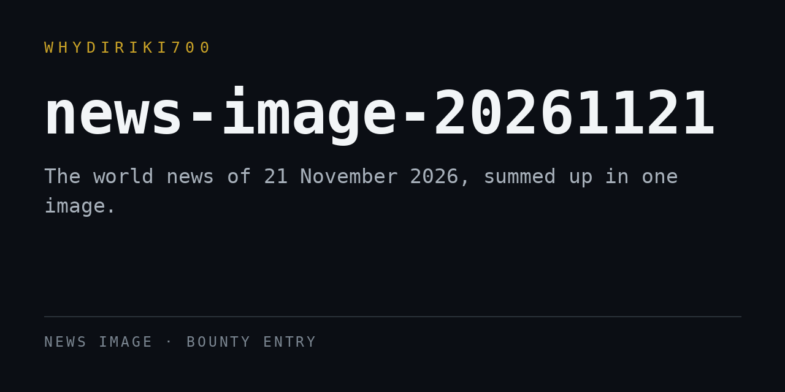

# news-image-20261121 — The World in One Image

A newspaper front page for Saturday 21 November 2026, drawn as a single 1024x1024 image. Built for the make.fun news-image-20261121 bounty, paid in USDC.

[](https://make.fun/bounty/news-image-20261121?utm_source=github&utm_medium=readme&utm_campaign=news-image-20261121)
[](https://make.fun/bounty/news-image-20261121/leaderboard?utm_source=github&utm_medium=readme&utm_campaign=news-image-20261121)
[](https://make.fun/bounty/news-image-20261121?utm_source=github&utm_medium=readme&utm_campaign=news-image-20261121)

## What is on the page

The lead is the war crossing NATO's border: Russian Kh-101 missiles hit Polish territory during the mass strike on Ukraine, Warsaw asks the alliance for support, and Danish Gripen jets engage over Poland. Six panels carry the rest of the day: the $4 trillion AI wipeout that sent the Nasdaq to its worst week since March 2020 and the S&P 500 into correction; Putin and Trump targeting the world court in the Shenzhen declaration while Xi presses Washington on Taiwan; Moscow's mass strike a day after the summit, with Kryvyi Rih counting its dead; COP31 climate talks nearing crunch time with no deal in sight; Myanmar and China rejecting the ICJ genocide ruling as unjust; and JPMorgan, Visa and Mastercard reporting a cyberattack on shared vendors. A bottom strip sweeps up the Houthi workshops destroyed in Sana'a, the IRGC claim beyond Hormuz, the 900,000 AI chips approved for China, Cyclone Akvan's landfall, the EU's billion-euro arms package, Bukele's third-term bid, the new South China Sea runway and Europe's offer of talks to Moscow.

## How it was built

The page is typeset in HTML with real text and rendered to PNG, so every headline stays sharp at small sizes. `main.ts` is the entrypoint: it checks `entry.png` is a genuine PNG inside the 1024x1024 and 1 MiB limits, then copies it byte for byte to `/output/entry.png` and logs the page's SHA-256 fingerprint.

Run it locally:

```
MAKEFUN_OUTPUT_DIR=out node main.ts
```

## The bounty

[news-image-20261121 on make.fun](https://make.fun/bounty/news-image-20261121) — real bounties, real USDC. New here? Join through https://make.fun/r/vwpycztt

## License

MIT — see `LICENSE`.
